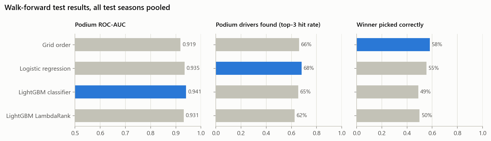
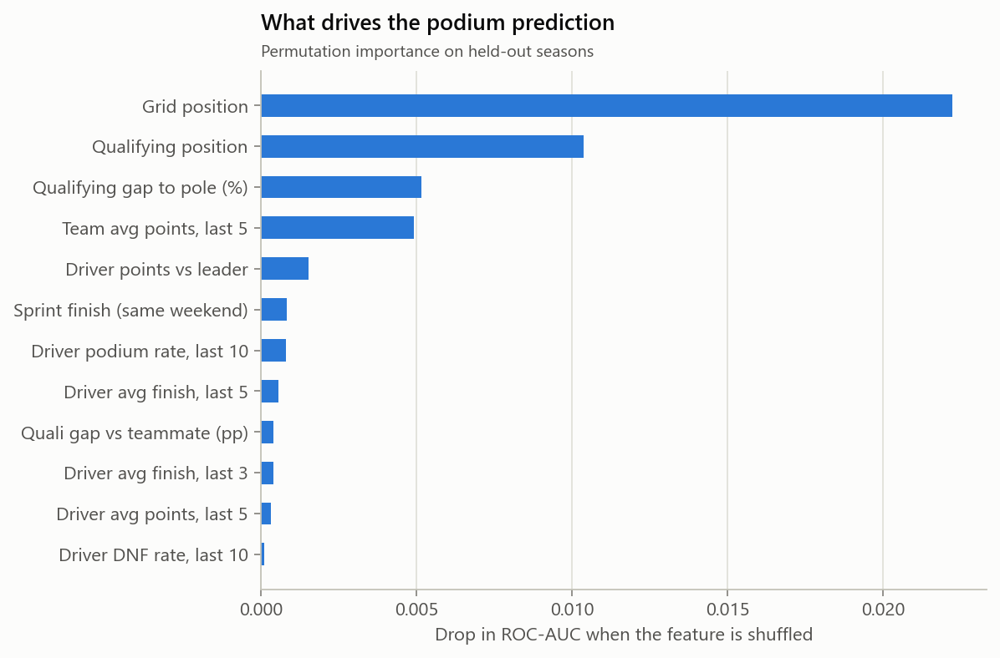
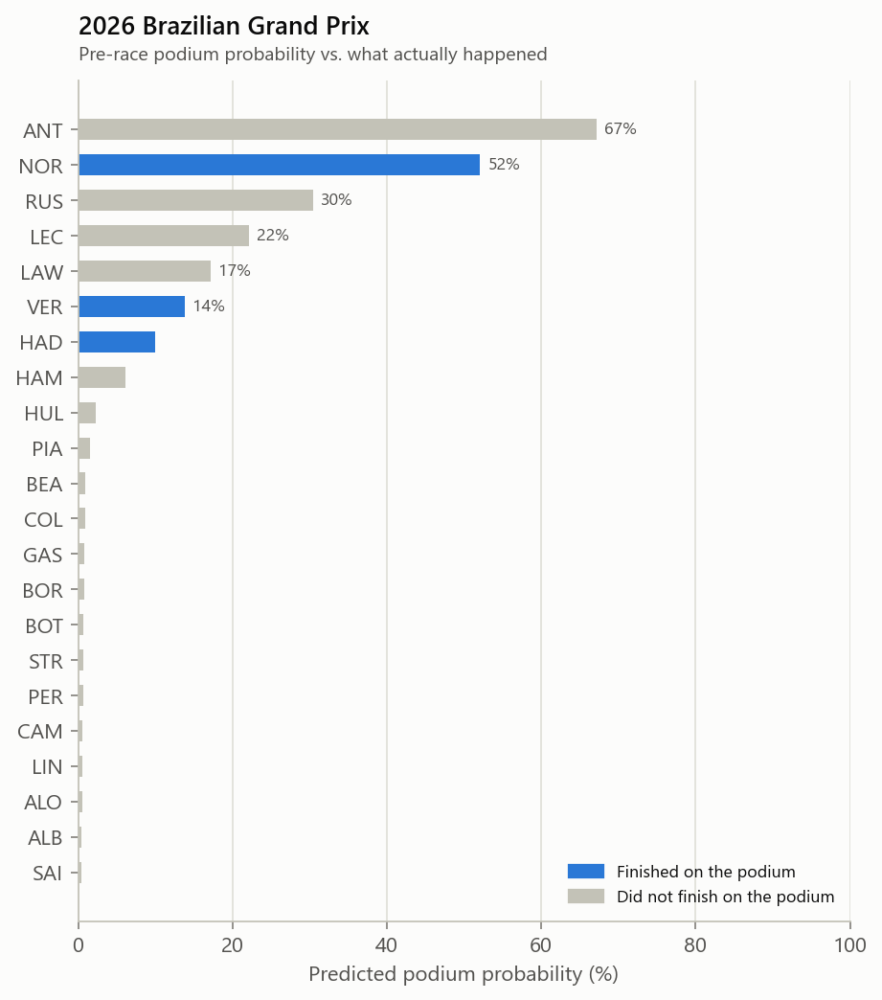
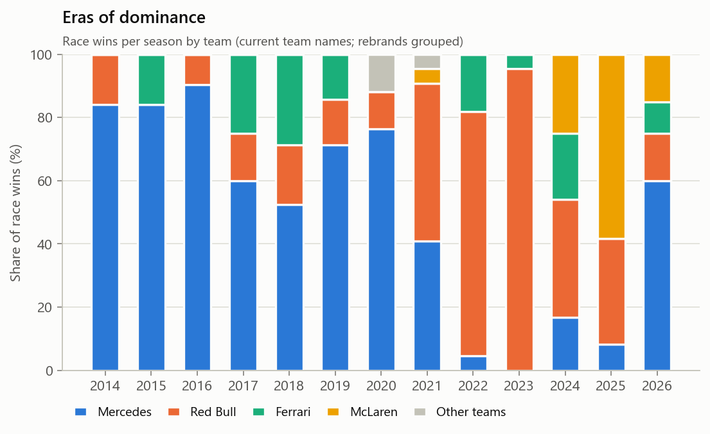
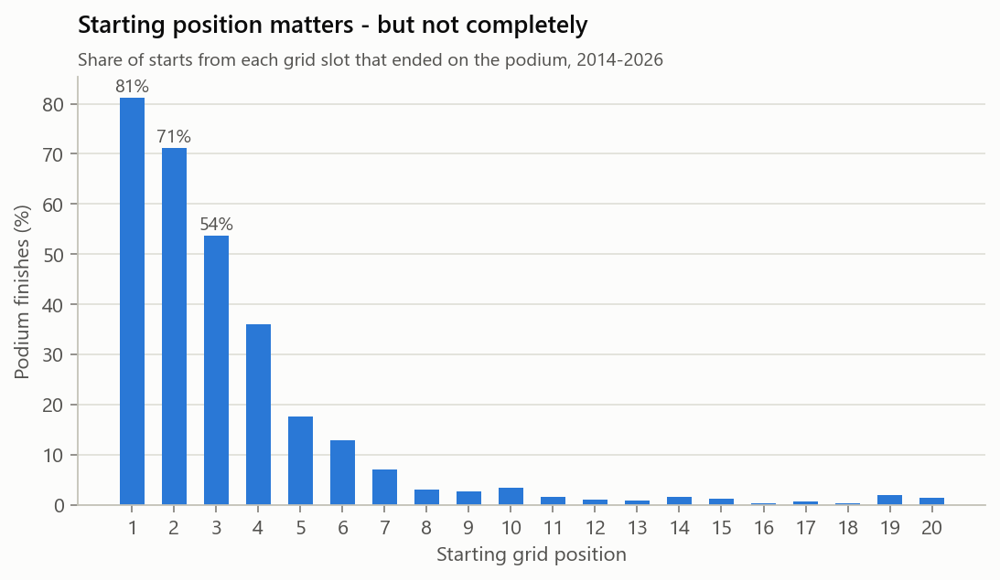

# F1 Race Outcome Predictor

[](https://github.com/manookello/f1-race-outcome-predictor/actions/workflows/ci.yml)


**Can you predict a Formula 1 podium before the lights go out?** This project models every
Grand Prix from 2014 (start of the turbo-hybrid era) to the latest 2026 round. It predicts each
driver's **podium probability** and the **full finishing order** using only information available
on race morning, and tests the models honestly with walk-forward validation across five seasons
and two regulation resets.



## Key results

Out-of-sample, 2022–2026 (112 races). Each season was predicted by models trained only on
earlier seasons.

| Model | ROC-AUC (podium) | Log loss | Top-3 hit rate | Winner accuracy | Spearman (full order) |
|---|---|---|---|---|---|
| Grid order (baseline) | 0.919 | – | 66.1% | **58.0%** | 0.630 |
| Logistic regression | 0.935 | 0.223 | **68.2%** | 55.4% | **0.676** |
| **LightGBM classifier** | **0.941** | **0.212** | 65.5% | 49.1% | 0.662 |
| LightGBM LambdaRank | 0.931 | – | 62.5% | 50.0% | 0.673 |

**What this shows**

- **The models give better probabilities than the grid.** LightGBM beats grid order on ROC-AUC
  in *every* test season (e.g. 0.953 vs 0.930 in 2025). Its probabilities are well calibrated
  ([calibration plot](reports/figures/calibration.png)).
- **Naming the exact podium is hard, and the grid is a brutal baseline.** From 2014 to 2026 the
  car starting from P1 won 55% of races and reached the podium 81% of the time. The models match
  or slightly beat the grid on top-3 hit rate, but "P1 wins" is still the best single winner pick.
- **Form matters most in dominant eras.** In 2023, logistic regression picked the winner in
  **91%** of races, against 64% for grid order. It learned that Verstappen tended to win even
  when he didn't start on pole.
- **Regulation resets break form features at first.** In rounds 1–5 of 2026 the learned
  models were no better than the grid, because the rolling form they rely on still described the
  2025 cars. From round 6 onward LightGBM pulled clearly ahead (AUC 0.945 vs 0.916).

<p align="center">
  
  
</p>

## Data

- **Source:** the [Jolpica-F1 API](https://github.com/jolpica/jolpica-f1), the community-run
  successor to Ergast.
- **Coverage:** race results, qualifying (Q1/Q2/Q3 times) and sprint results, 2014–2026. That is
  272 races and 5,545 driver-race rows.
- **Collection:** `f1predict.data` throttles to 1 request per second, retries on 429/5xx and
  caches raw JSON locally. The tidy parquet tables are committed in `data/processed/`, so
  nothing below needs network access.

<p align="center">
  
  
</p>

## Method

**Features.** There are 21 features, all computed strictly from pre-race information
(`src/f1predict/features.py`). Rolling windows always `shift(1)` first, and unit tests guard
against leakage.

| Group | Features |
|---|---|
| Grid & qualifying | grid slot, pit-lane start, qualifying position, % gap to pole, gap vs teammate |
| Same weekend | sprint finishing position (sprint weekends only) |
| Driver form | rolling average finish (3 and 5 races), average points, podium rate, DNF rate, career starts |
| Championship | driver & team championship rank before the race, driver points as a share of the leader's |
| Team form | rolling team points and best finish over 5 races (rebrands such as Toro Rosso → AlphaTauri → RB are merged) |
| Circuit | driver's average past finish and number of starts at this circuit, street-circuit flag, round number |

**Models.**
- Logistic regression (imputation + scaling).
- LightGBM binary classifier for P(podium).
- LightGBM **LambdaRank**, which learns the order of the whole field per race.
- Baseline: finishing order = grid order.

**Validation.** Walk-forward by season: to score season *Y*, train on 2014…*Y*−1. The
hyperparameters were chosen on validation seasons 2019–2021 before looking at the 2022–2026 test
seasons.

**Metrics.**
- ROC-AUC, log loss and Brier score for probability quality.
- Top-3 hit rate and winner accuracy for "who's on the podium".
- Per-race Spearman correlation for the full finishing order.

## Project structure

```
├── app/streamlit_app.py        # interactive explorer (race predictions, metrics, eras)
├── data/processed/             # tidy tables + features, predictions, metrics (committed)
├── models/podium_lgbm.joblib   # podium classifier trained on all races to date
├── notebooks/
│   ├── 01_data_collection.ipynb
│   ├── 02_eda.ipynb
│   ├── 03_modeling.ipynb       # walk-forward evaluation, calibration, importance, drift
│   └── 04_predict_a_race.ipynb # strict as-of replay of the latest Grand Prix
├── reports/figures/            # charts used in this README
├── src/f1predict/              # data, features, model, plots
└── tests/                      # feature leakage guards, metric tests, app smoke test
```

## Quickstart

```bash
git clone https://github.com/manookello/f1-race-outcome-predictor.git
cd f1-race-outcome-predictor
python -m venv .venv && source .venv/bin/activate   # Windows: .venv\Scripts\activate
pip install -r requirements.txt -r requirements-dev.txt
pip install -e . --no-deps

streamlit run app/streamlit_app.py      # explore the results
pytest                                  # run the tests

python -m f1predict.data --start 2014 --end 2026   # optional: refresh data from the API
```

## Limitations & next steps

- The models don't see weather forecasts, grid penalties announced after qualifying, or tyre
  allocations.
- Form features lag behind after regulation changes. Possible fixes are down-weighting
  pre-reset races or adding a "races since reset" feature.
- The podium probabilities are independent per driver, so they don't sum to exactly 3 per race.
  A Plackett–Luce or Monte-Carlo layer on top of the ranker would give coherent race-level
  probabilities.

## Related projects

- [f1-tyre-strategy-analysis](https://github.com/manookello/f1-tyre-strategy-analysis): tyre
  degradation, lap-time modelling, a strategy simulator and telemetry.
- [motogp-performance-analytics](https://github.com/manookello/motogp-performance-analytics): the
  same modelling approach applied to MotoGP, plus crash-risk modelling.
- [f1-vs-motogp-circuits](https://github.com/manookello/f1-vs-motogp-circuits): lap times at
  shared circuits and which championship is more competitive.

---

Data © the Jolpica-F1 project contributors. This project is unofficial and is not associated with
Formula 1 or the FIA.
